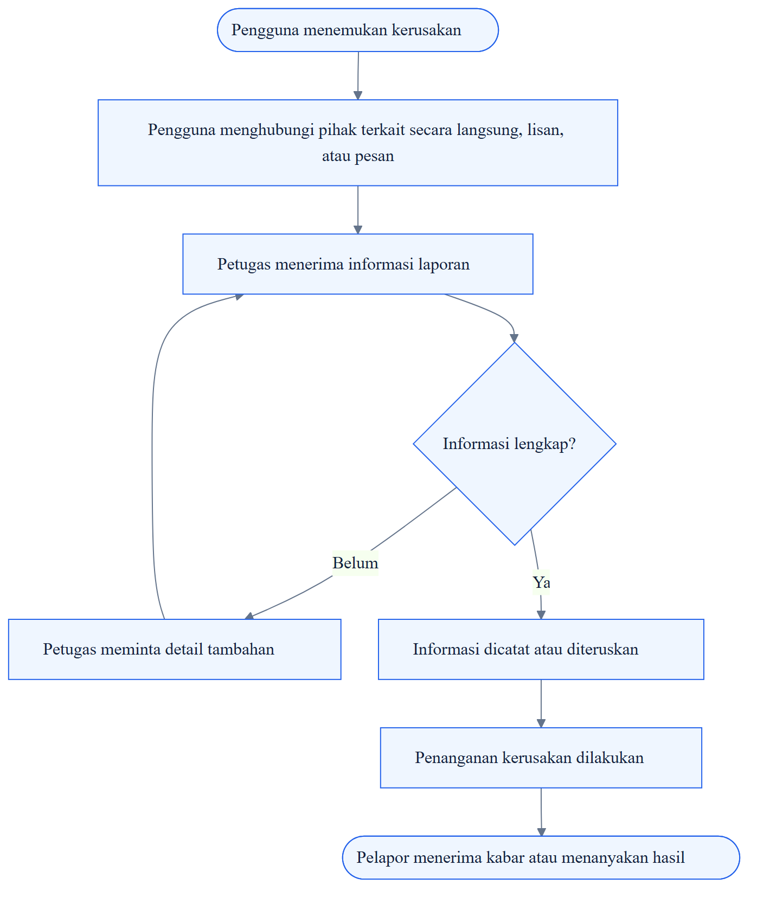
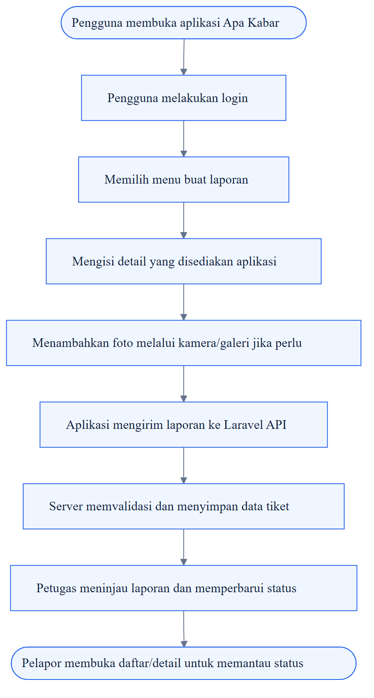

  

<h1 align="center">Apa Kabar</h1>

  <strong>Aplikasi Pelaporan Kerusakan Barang &amp; Fasilitas</strong> 
  Analisis Kebutuhan Pengguna &amp; Karakteristik Perangkat Bergerak

  Pemrograman Bergerak · Tugas 1 · TA 2026/2027

---

| Item | Detail |
|---|---|
| **Mata kuliah** | Pemrograman Bergerak |
| **Nama mahasiswa** | Rifandi Usdan Fanani Putra |
| **NIM** | 2305101086 |
| **Program studi / institusi** | Teknik Informatika / Universitas PGRI Madiun |

> **⚠️ Validitas data**
>
> Dokumen ini merupakan analisis awal berdasarkan fungsi dan arsitektur proyek. Belum ada data wawancara atau observasi lapangan yang diberikan. Pernyataan tentang kondisi proses manual ditandai sebagai hipotesis dan perlu divalidasi.

## Daftar Isi

- [1. Ringkasan Eksekutif](#1-ringkasan-eksekutif)
- [2. Latar Belakang dan Masalah](#2-latar-belakang-dan-masalah)
- [3. Sistem yang Berjalan](#3-sistem-yang-berjalan)
- [4. Sistem yang Ditawarkan](#4-sistem-yang-ditawarkan)
- [5. Kebutuhan Pengguna](#5-kebutuhan-pengguna)
- [6. Karakteristik Perangkat Bergerak](#6-karakteristik-perangkat-bergerak)
- [7. Spesifikasi Pengembang](#7-spesifikasi-pengembang)
- [8. Spesifikasi Target dan Pengujian](#8-spesifikasi-target-dan-pengujian)
- [9. Kesimpulan dan Referensi](#9-kesimpulan-dan-referensi)
- [Checklist Sebelum Pengumpulan](#checklist-sebelum-pengumpulan)

---

## 1. Ringkasan Eksekutif

### Mengapa Apa Kabar relevan sebagai solusi mobile?

Apa Kabar merupakan aplikasi ticketing untuk membantu pengguna menyampaikan laporan kerusakan barang atau fasilitas, melampirkan bukti foto (hingga beberapa gambar), serta memantau perkembangan laporan. Dari sisi pengelola, sistem membantu petugas menerima, memeriksa, dan memperbarui status tiket secara lebih terpusat.

Arsitektur aktif proyek menggunakan **Vue.js + Vite** untuk antarmuka, **Node.js + Express 5 + TypeScript** sebagai REST API, **Prisma 7 + PostgreSQL** untuk akses dan penyimpanan data, serta **Capacitor** untuk membungkus aplikasi menjadi aplikasi Android. Laravel 12/MySQL merupakan arsitektur backend lama dan referensi historis, bukan backend aktif saat ini. Fokus dokumen tetap pada kebutuhan pengguna, alur kerja, karakteristik mobile, dan target yang dapat diuji.

### Tujuan dokumen

- Mengidentifikasi pengguna dan kebutuhan utama dalam proses pelaporan kerusakan.
- Membandingkan sistem yang berjalan dengan alur sistem yang ditawarkan.
- Menentukan dampak layar, kamera/galeri, konektivitas, dan keamanan perangkat bergerak.
- Menyusun spesifikasi pengembang serta target fungsional dan nonfungsional yang dapat diuji.

> **🎯 Ruang lingkup**
>
> Autentikasi, pembuatan laporan (termasuk lokasi), lampiran gambar (hingga 5 gambar per tiket), daftar/detail tiket, pemantauan status, balasan/tindak lanjut, serta peran pengelola sesuai implementasi yang benar-benar ada.

### Alur utama aplikasi

| Tahap | Fokus | Penjelasan |
|---|---|---|
| **01 / Lapor** | Buat laporan terstruktur | Formulir membantu mengumpulkan detail dan bukti kerusakan. |
| **02 / Kelola** | Informasi tiket lebih terpusat | Data tiket dapat diperiksa sesuai hak akses. |
| **03 / Pantau** | Cek perkembangan laporan | Pelapor melihat status terbaru dari backend. |

---

## 2. Latar Belakang dan Masalah

### Mendefinisikan masalah sebelum menentukan solusi

Kerusakan barang atau fasilitas membutuhkan proses pelaporan yang jelas agar informasi sampai kepada pihak yang bertanggung jawab dan dapat ditindaklanjuti. Jika laporan disampaikan secara lisan atau lewat pesan yang tersebar, informasi bisa tidak seragam, bukti kerusakan sulit dihimpun, dan pelapor belum tentu memiliki cara terstruktur untuk mengetahui perkembangan penanganan.

> **📌 Batasan analisis**
>
> Pernyataan tersebut adalah konteks masalah yang perlu dikonfirmasi pada lingkungan penggunaan sebenarnya, bukan hasil observasi yang sudah terukur.

### Potensi masalah yang dianalisis

| Aspek | Potensi masalah | Dampak yang mungkin | Cara validasi |
|---|---|---|---|
| **Pelaporan** | Laporan berpotensi masuk lewat beberapa kanal atau lisan. | Informasi sulit ditelusuri dalam satu tempat. | Wawancara pelapor dan petugas; amati proses aktual. |
| **Kelengkapan** | Detail lokasi/kerusakan atau bukti foto mungkin tidak selalu ada. | Petugas perlu meminta klarifikasi tambahan. | Tinjau contoh laporan terdahulu dengan izin. |
| **Status tindak lanjut** | Pelapor mungkin belum dapat melihat status terkini secara mandiri. | Pertanyaan status berulang dapat terjadi. | Tanyakan bagaimana status dibagikan saat ini. |
| **Dokumentasi** | Riwayat laporan berpotensi tersebar pada catatan/pesan. | Rekap dan pencarian laporan lebih sulit. | Tinjau media pencatatan yang benar-benar digunakan. |

### Data temuan yang harus dikumpulkan

Agar tugas memenuhi unsur “data temuan”, lakukan wawancara singkat dengan calon pelapor dan petugas/pengelola. Catat tanggal, peran responden tanpa data sensitif, pertanyaan, jawaban ringkas, dan bukti proses yang diizinkan. Jangan menulis jumlah responden, persentase, atau kesimpulan kuantitatif sebelum data benar-benar diperoleh.

| Pertanyaan wawancara | Catatan jawaban |
|---|---|
| 1. Bagaimana laporan kerusakan disampaikan saat ini? | _Diisi saat wawancara_ |
| 2. Informasi apa yang wajib disertakan? | _Diisi saat wawancara_ |
| 3. Bagaimana pelapor mengetahui status laporan? | _Diisi saat wawancara_ |
| 4. Apakah foto dari ponsel dibutuhkan? | _Diisi saat wawancara_ |

---

## 3. Sistem yang Berjalan

### Hipotesis alur pelaporan sebelum aplikasi digunakan

Flowchart berikut adalah gambaran awal alur pelaporan manual/tersebar. Revisi setiap langkah berdasarkan praktik nyata di lingkungan kampus atau instansi tempat aplikasi akan digunakan.

  

### Pertanyaan analisis untuk memeriksa kelemahan alur

- Apakah laporan memiliki format informasi yang sama?
- Apakah pelapor menerima nomor atau bukti bahwa laporan sudah diterima?
- Apakah status dan riwayat dapat dilihat tanpa menghubungi petugas?
- Bagaimana foto disimpan dan siapa yang dapat mengaksesnya?
- Bagaimana petugas menentukan prioritas dan mencegah laporan ganda?

### Referensi pembanding

SP4N-LAPOR! merupakan contoh layanan pengaduan digital yang menyediakan kanal penyampaian laporan serta informasi tindak lanjut. Referensi ini digunakan sebagai pembanding pola layanan digital, bukan sebagai bukti bahwa proses di kampus memiliki prosedur yang sama.

- <https://sp4n.lapor.go.id/>
- <https://lapor.go.id/faq>

---

## 4. Sistem yang Ditawarkan

### Pelaporan mobile dengan pencatatan dan pemantauan tiket

Apa Kabar ditawarkan sebagai aplikasi Android untuk mengirim laporan dan memantau perkembangannya. Petugas menggunakan antarmuka pengelolaan yang tersedia untuk memeriksa laporan dan memperbarui status sesuai hak akses.

  

### Arsitektur solusi

`Vue.js` · `Vite` · `Capacitor Android` · `Node.js` · `Express 5` · `TypeScript` · `Prisma 7` · `PostgreSQL` · `REST API + HTTPS`

| Lapisan | Komponen | Tanggung jawab |
|---|---|---|
| **Mobile UI** | Vue.js + Capacitor | Login, formulir laporan, daftar/detail tiket, balasan, dan interaksi pengguna. |
| **API** | Node.js + Express 5 + TypeScript | Autentikasi, validasi, proses bisnis (termasuk deteksi duplikat, cooldown, batas harian), otorisasi, rate limiting, dan respons data. |
| **Database** | PostgreSQL melalui Prisma 7 | Menyimpan akun, tiket, balasan, status, dan metadata lampiran (termasuk relasi multi-gambar). |
| **Berkas** | Storage gambar lokal | Menyimpan foto di `backend/storage` dan menyajikannya melalui endpoint `/storage`. Untuk produksi, dapat dipindahkan ke object storage/disk persisten. |

> **Status implementasi:** source backend aktif berada di `backend/`. Frontend Vue memakai `VITE_API_BASE_URL` untuk mengakses API. Source PHP Laravel lama tidak disertakan di workspace ini. Integrasi end-to-end pada browser/perangkat Android dan konfigurasi build Capacitor tetap perlu diuji pada lingkungan target.

### Alur status tiket (implementasi saat ini)

**`open` (Dibuka)** → **`in_progress` (Diproses)** → **`resolved` (Selesai)** / **`rejected` (Ditolak)**

> **ℹ️ Catatan**
>
> Nilai status di atas mengikuti implementasi backend saat ini (`open`, `in_progress`, `resolved`, `rejected`). Jika alur bisnis membutuhkan tahap verifikasi terpisah, penyesuaian skema dan logika status perlu dilakukan secara eksplisit.

---

## 5. Kebutuhan Pengguna

### Dari peran pengguna ke kebutuhan yang dapat diuji

| Pengguna | Tujuan | Kebutuhan utama |
|---|---|---|
| **Pelapor** (mahasiswa / pengguna fasilitas) | Melaporkan kerusakan dan mengetahui perkembangan. | Login; formulir laporan (termasuk lokasi) yang mudah; unggah hingga beberapa foto bukti; daftar/detail tiket; balasan; status yang jelas. |
| **Petugas** (admin pengelola) | Memeriksa laporan dan mengatur tindak lanjut. | Melihat tiket, lampiran, dan riwayat balasan; memperbarui status; memberikan tanggapan; mengelola data sesuai kewenangan. |

### Kebutuhan fungsional

| ID | Kebutuhan | Prioritas | Kriteria penerimaan awal |
|---|---|---|---|
| **KF-01** | Login dan logout pengguna. | **Tinggi** | Kredensial valid membuka sesi; kredensial salah menghasilkan pesan yang jelas. |
| **KF-02** | Membuat tiket/laporan. | **Tinggi** | Field wajib (mis. judul, kategori, lokasi, prioritas, deskripsi) divalidasi; laporan berhasil tersimpan dan muncul pada daftar/detail. |
| **KF-03** | Menambahkan foto bukti. | **Tinggi** | Mendukung hingga 5 gambar per tiket (format `JPG/PNG/WEBP`, maks. 10 MB per file); gambar tersimpan dan dapat dilihat kembali pada detail tiket. |
| **KF-04** | Melihat daftar dan detail tiket. | **Tinggi** | Data sesuai akun dan izin akses pengguna. |
| **KF-05** | Memantau status tiket. | **Tinggi** | Status mengikuti nilai terakhir dari server (`open`, `in_progress`, `resolved`, `rejected`). |
| **KF-06** | Petugas meninjau tiket dan memperbarui status. | **Tinggi** | Perubahan tersimpan dan terlihat oleh pelapor yang berwenang. |
| **KF-07** | Balasan/tindak lanjut tiket. | **Sedang** | Pengguna/petugas dapat mengirim balasan sesuai hak akses; riwayat balasan tampil pada detail tiket. |
| **KF-08** | Pencegahan duplikat & pembatasan pengiriman. | **Sedang** | Sistem mendeteksi tiket serupa dalam jendela waktu tertentu, memberi opsi konfirmasi, serta menerapkan cooldown/batas harian dan rate limit untuk mencegah pengiriman berulang/berlebihan. |

---

## 6. Karakteristik Perangkat Bergerak

### Desain harus sesuai dengan cara orang menggunakan ponsel

Pelaporan bisa dilakukan langsung di lokasi kejadian. Karena itu, antarmuka perlu mudah digunakan pada layar berbeda dan tetap memberi umpan balik ketika jaringan lambat atau gagal. Panduan Android menekankan tata letak adaptif dan pemisahan tanggung jawab UI serta data [1][2].

| Karakteristik | Implikasi pada Apa Kabar | Kebutuhan desain / pengujian |
|---|---|---|
| **Layar dan ukuran beragam** | Formulir dan teks harus terbaca tanpa terpotong. | Uji beberapa ukuran layar; label jelas dan tombol mudah disentuh. |
| **Kamera dan galeri** | Pengguna memerlukan bukti visual kerusakan (bisa lebih dari satu sudut). | Uji izin akses, pemilihan satu/beberapa gambar, preview & hapus per gambar, batas jumlah/ukuran/format, dan pesan gagal. |
| **Koneksi berubah-ubah** | Request API dapat gagal, lambat, atau terkirim ulang. | Tampilkan loading/error; cegah submit ganda; sediakan coba lagi; konfirmasi sukses hanya setelah respons server; manfaatkan idempotency untuk mencegah tiket ganda saat retry. |
| **Siklus aplikasi** | OS dapat menghentikan proses aplikasi. | Muat ulang status dari API; jangan mengandalkan memori layar untuk data penting. |
| **Keamanan dan privasi** | Foto dan isi laporan dapat bersifat sensitif. | Gunakan HTTPS, otorisasi backend, hindari token di log, batasi akses file, dan terapkan rate limiting. |
| **Data, baterai, dan spam** | Foto besar dan pengiriman berulang membebani jaringan/server. | Batasi ukuran/jumlah foto, deteksi tiket duplikat, terapkan cooldown/batas harian, dan hindari request berulang yang tidak perlu. |

> **⚠️ Batasan yang perlu diverifikasi**
>
> Capacitor membungkus frontend Vue menjadi aplikasi Android, tetapi kemampuan native tertentu tetap bergantung pada konfigurasi dan plugin. Notifikasi push, kamera native, atau mode offline tidak boleh dinyatakan sudah tersedia hanya karena perangkat Android mendukungnya.

### Prinsip UX: umpan balik tiga keadaan

Beri umpan balik yang jelas pada tiga keadaan utama: **sedang mengirim, berhasil terkirim, dan gagal terkirim**. Ini mengurangi kebingungan serta risiko pengiriman laporan berulang.

| Keadaan | Umpan balik yang diberikan |
|---|---|
| **Sedang mengirim** | Tampilkan progres dan nonaktifkan tombol kirim. |
| **Berhasil terkirim** | Konfirmasi hanya setelah server merespons sukses. |
| **Gagal terkirim** | Jelaskan penyebab dan sediakan tombol coba lagi. |

---

## 7. Spesifikasi Pengembang

### Komponen teknis untuk membangun dan memelihara aplikasi

Spesifikasi pengembang merangkum kebutuhan perangkat lunak dan layanan yang digunakan untuk membangun, menjalankan, menguji, serta memelihara Apa Kabar.

| Komponen | Spesifikasi | Peran |
|---|---|---|
| **Frontend** | Vue.js + Vite | Membangun antarmuka dan mengirim request ke REST API. |
| **Mobile wrapper** | Capacitor Android | Mengemas frontend sebagai aplikasi Android untuk pengujian pada perangkat fisik. |
| **Backend** | Node.js + Express 5 + TypeScript + Prisma 7 | Menangani autentikasi, validasi, proses tiket, dan respons API. |
| **Database** | PostgreSQL | Menyimpan akun, tiket, status, dan metadata lampiran. |
| **Tools pengembangan** | VS Code, Node.js/npm, Prisma CLI, Android Studio, Git/GitHub | Mendukung build frontend/backend, pengujian Android, dan version control. PHP/Composer hanya diperlukan bila memelihara backend Laravel lama. |
| **Pengujian** | HP Android fisik + backend aktif | Menguji login, tiket, detail, status, gambar, jaringan, dan hak akses. |
| **Deployment** | API HTTPS + storage persisten | Memberi URL yang dapat diakses lintas jaringan; menjaga ketersediaan file gambar. |

### Prasyarat operasional

- Repository frontend/backend teridentifikasi dengan jelas dan rahasia tidak disimpan di Git.
- URL API dikelola melalui konfigurasi environment (`VITE_API_BASE_URL`, `PUBLIC_BASE_URL`, dsb.), bukan tersebar di banyak file.
- Skema database dapat direproduksi melalui migration Prisma dan memiliki backup sebelum perubahan data.
- Storage foto (lokal `backend/storage` atau storage persisten lain) tetap tersedia dan dapat diakses setelah deployment ulang.
- Build Android diuji kembali setelah perubahan URL API, konfigurasi Capacitor, atau perilaku upload/lampiran.

---

## 8. Spesifikasi Target dan Pengujian

### Definisi keberhasilan yang bisa dibuktikan

| Target | Indikator berhasil | Cara verifikasi |
|---|---|---|
| **Pelaporan terstruktur** | Pengguna mengisi field wajib (termasuk lokasi) dan mengirim tiket dengan respons yang jelas. | Uji data valid/tidak valid dan cek data tersimpan. |
| **Lampiran bukti** | Hingga 5 foto (sesuai batas format/ukuran) dapat dilihat kembali setelah aplikasi ditutup dan dibuka. | Uji unggah tunggal/multi-gambar, buka detail (user/admin), restart aplikasi, dan cek persistence storage. |
| **Pelacakan status & balasan** | Daftar/detail menunjukkan status terbaru dari server dan riwayat balasan tampil sesuai hak akses. | Ubah status/balas tiket melalui peran petugas, lalu verifikasi dari akun pelapor. |
| **Kesesuaian mobile** | Layar tidak terpotong dan kontrol utama (termasuk pilih kamera/galeri & preview multi-gambar) dapat digunakan. | Uji pada perangkat/ukuran layar berbeda, termasuk izin kamera/galeri. |
| **Koneksi dan error** | Kegagalan jaringan atau request ulang tidak menghasilkan konfirmasi sukses palsu/tiket ganda. | Putuskan jaringan saat request, coba lagi, dan verifikasi perilaku loading/error/idempotency. |
| **Pencegahan duplikat & pembatasan** | Sistem memberi peringatan duplikat, opsi konfirmasi, serta menolak pengiriman yang melanggar cooldown/batas harian/rate limit dengan pesan jelas. | Uji tiket serupa beruntun, submit cepat berulang, dan pembuatan tiket hingga melewati batas yang ditetapkan. |
| **Keamanan akses** | Pengguna hanya mengakses data sesuai otorisasinya. | Uji token tidak valid, akses ke tiket pengguna lain, dan respons 401/403 yang sesuai. |

### Target nonfungsional awal

| Aspek | Target |
|---|---|
| **Usability** | Alur membuat laporan singkat; instruksi, validasi, dan pesan error mudah dipahami. |
| **Reliability** | Status loading, sukses, dan gagal ditampilkan secara eksplisit; pencegahan duplikat/cooldown/batas harian membantu menghindari pengiriman berulang. |
| **Security** | HTTPS pada produksi, validasi server-side, kontrol akses, dan rate limiting untuk mencegah penyalahgunaan. |
| **Maintainability** | URL API, rahasia, dan konfigurasi environment dipisahkan dari source code. |

> **📝 Lengkapi dengan data nyata**
>
> Tambahkan hasil wawancara/observasi aktual, tanggal, peran responden, dan ringkasan jawaban. Hindari nama lengkap atau informasi pribadi jika tidak diperlukan. Jika belum ada data, nyatakan bahwa validasi lapangan masih menjadi pekerjaan lanjutan.

---

## 9. Kesimpulan dan Referensi

### Kesimpulan

Apa Kabar relevan sebagai aplikasi bergerak karena proses pelaporan kerusakan dapat membutuhkan input dan bukti visual langsung dari lokasi. Solusi mobile berpotensi memusatkan data, mempermudah pelampiran bukti, dan membantu pelacakan status—dengan syarat kebutuhan ini divalidasi terhadap pengguna sebenarnya.

Keberhasilan tidak hanya ditentukan oleh tampilan Android. Backend perlu dapat diakses secara aman, otorisasi harus benar, dan foto laporan harus disimpan secara persisten. Pengujian pada perangkat nyata serta kondisi jaringan yang beragam merupakan bagian penting dari pemenuhan kebutuhan mobile.

> “Aplikasi mobile yang baik bukan hanya memindahkan formulir ke ponsel — aplikasi harus membantu pengguna mengirim informasi dengan jelas, aman, dan dapat ditindaklanjuti.”

### Referensi

1. Android Developers. “Guide to app architecture.” <https://developer.android.com/topic/architecture>
2. Android Developers. “Adapt layouts.” <https://developer.android.com/design/ui/mobile/guides/layout-and-content/adapt-layout>
3. Android Developers. “Responsive and adaptive design with Views.” <https://developer.android.com/develop/ui/views/layout/responsive-adaptive-design-with-views>
4. SP4N-LAPOR! “Layanan Aspirasi dan Pengaduan Online Rakyat.” <https://sp4n.lapor.go.id/>
5. LAPOR! “Pertanyaan Seputar LAPOR!” <https://lapor.go.id/faq>
6. Express. “Express 5.x Documentation.” <https://expressjs.com/>
7. Capacitor. “Documentation.” <https://capacitorjs.com/docs>
8. Prisma. “Prisma ORM Documentation.” <https://www.prisma.io/docs>
9. Laravel. “Laravel 12.x Documentation.” <https://laravel.com/docs/12.x> (referensi backend lama)

---

## Checklist Sebelum Pengumpulan

- [ ] Isi nama, NIM, mata kuliah, dan identitas kampus.
- [ ] Cocokkan flowchart dengan proses sebenarnya.
- [ ] Tambahkan data wawancara/observasi aktual.
- [ ] Verifikasi setiap fitur terhadap repository Apa Kabar.
- [ ] Konsisten menggunakan istilah pelapor, petugas, tiket, dan status.

---

  <strong>Apa Kabar · Dokumen Tugas 1</strong> 
  Pemrograman Bergerak · Teknik Informatika · Universitas PGRI Madiun · 2026/2027

